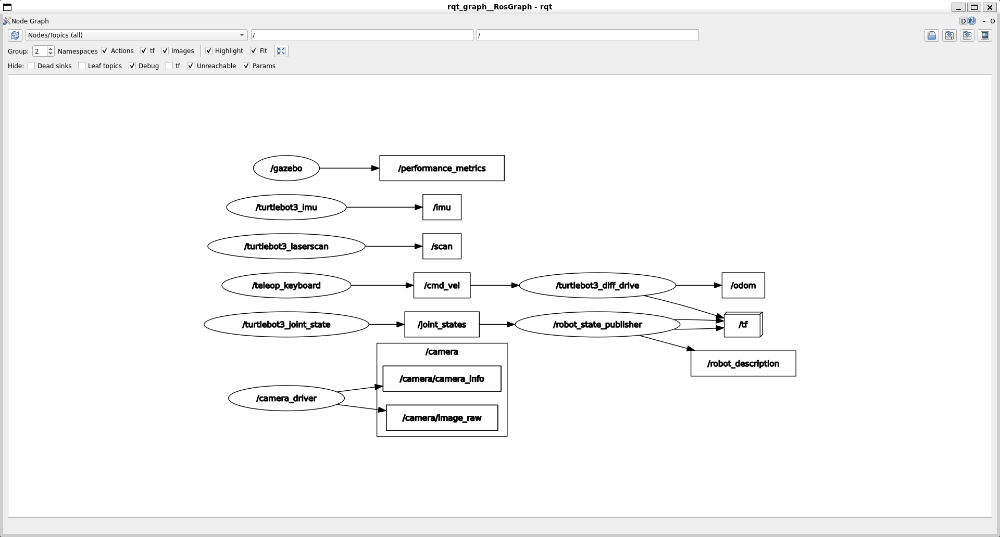
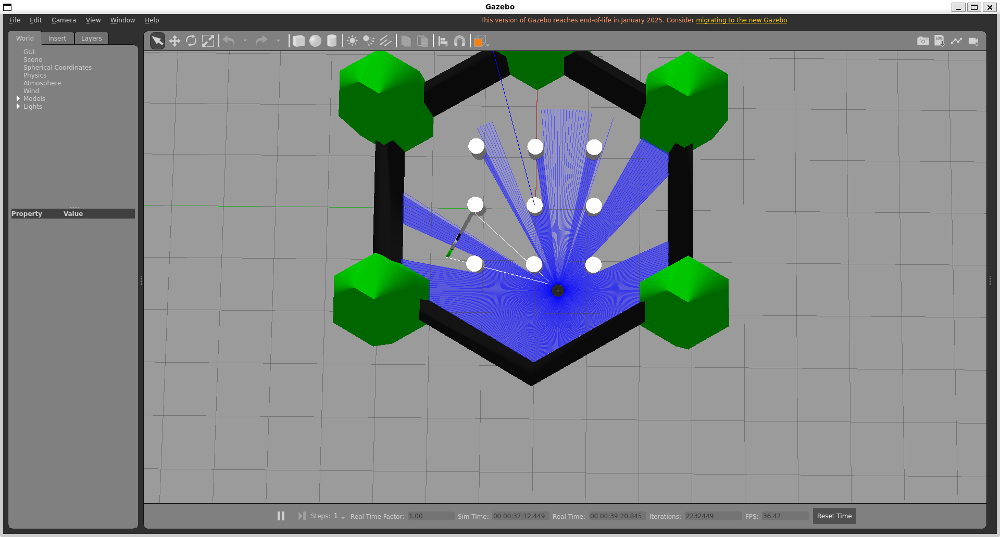

# 2026-11-26 학습 기록

[학습 계획](../learning-plan.md) **1단계(그래프 읽기)** 진행 중. `rqt_graph`로 노드와 토픽 구조를 읽었다.

## 오늘 한 것

- `rqt_graph`의 표시 모드와 Hide 옵션을 바꿔 가며 그래프 읽기
- Gazebo 화면과 ROS2 노드의 관계 정리

## 1. rqt_graph

- rqt는 ROS2 GUI 도구 모음이고, rqt_graph는 **지금 실행 중인** 노드·토픽 연결을 그려 준다. 설계도가 아니라 현재 상태다.
- 노드가 시작할 때 DDS 디스커버리로 서로를 알리고, rqt_graph가 그 정보를 수집한다.

### 표시 모드

| 모드 | 보여 주는 것 |
|---|---|
| Nodes only | 노드 사이의 연결만 |
| Nodes/Topics (active) | 발행자와 구독자가 모두 있는 토픽만 |
| Nodes/Topics (all) | 발행만 있거나 구독만 있는 토픽도 포함 |

### Hide 옵션

| 옵션 | 숨기는 것 |
|---|---|
| Dead sinks, Leaf topics | 구독자 없이 발행만 되는 토픽 (`/scan`, `/odom` 등이 여기에 걸림) |
| Debug | `/clock`, `/rosout`, rqt 자신의 노드 |
| tf | `/tf`, `/tf_static` |
| Params | 파라미터 관련 토픽 |

- `/scan` 등을 보려면 **all** 모드에서 Dead sinks, Leaf topics를 꺼야 한다.
- 공부할 때는 Debug를 켜 둬서(숨겨서) `/clock`, `/rosout`을 가리는 편이 구조가 잘 보인다.
- 복잡하게 보는 게 좋은 게 아니다. 단순한 화면(active)에서 시작해 점점 늘린다.



## 2. 노드와 토픽 (1단계 질문의 답)

화살표는 `노드 → 토픽 → 노드` 순서이고, 노드끼리 직접 연결되지 않고 항상 토픽을 거친다.

| 노드 | 발행 | 구독 | 역할 |
|---|---|---|---|
| `/teleop_keyboard` | `/cmd_vel` | | 키 입력을 속도 명령으로 변환 |
| `/turtlebot3_diff_drive` | `/odom`, `/tf` | `/cmd_vel` | 바퀴 구동, 위치 계산 |
| `/turtlebot3_joint_state` | `/joint_states` | | 바퀴 관절 각도 |
| `/robot_state_publisher` | `/tf`, `/robot_description` | `/joint_states` | 로봇 모델 + 관절 상태로 좌표 관계 계산 |
| `/turtlebot3_laserscan` | `/scan` | | LiDAR |
| `/turtlebot3_imu` | `/imu` | | IMU |
| `/camera_driver` | `/camera/image_raw`, `/camera/camera_info` | | 카메라 |
| `/gazebo` | `/performance_metrics` | | 시뮬레이터가 ROS2에 붙는 창구 |

- `/cmd_vel`은 teleop이 보내고 diff_drive가 받는다. `/scan`은 laserscan 노드가 만든다. 노드는 8개.
- 구독하는 노드는 `/cmd_vel`, `/joint_states` 두 곳뿐이다. 나머지 토픽은 받는 쪽이 없어도 계속 발행된다. 보내는 쪽은 받는 쪽을 모른다.
- 명령은 `/cmd_vel`로 들어가고 결과는 `/odom`, `/tf`로 나온다. 입력과 출력이 다른 토픽이다.
- `/odom`, `/tf`, `/robot_description`도 모두 토픽이다. 이름이 특별해 보이는 건 용도가 정해진 관례적 토픽이기 때문이다.
- `/tf`의 입체 상자는 rqt_graph의 `tf` 묶음 표시 기능 때문이다. 실제로는 `/tf`와 `/tf_static`이 별개 토픽이고(`topic list`로 확인), 그래프에서는 하나로 묶여 보인 것으로 추정한다.

### 인프라성 토픽 (Debug, Params를 껐을 때 나타남)

- `/rosout`: 모든 노드가 로그를 발행하는 공용 토픽. 구독자가 없어서 선이 전부 이쪽으로 들어가기만 한다.
- `/clock`: Gazebo의 시뮬레이션 시간. 센서·구동 노드들이 구독한다. teleop은 구독하지 않는다.
- `/parameter_events`: 파라미터 변경 알림. 모든 노드가 발행·구독한다. Params 옵션이 숨긴다.

### 관절(joint)

- 로봇 모델(URDF)은 부품(link)과 관절(joint)로 정의된다. TurtleBot3에서 움직이는 관절은 좌우 바퀴뿐이다.
- `/joint_states`에는 바퀴의 현재 각도와 속도가 담긴다.
- `robot_state_publisher`가 로봇 구조(`/robot_description`)와 현재 관절 상태(`/joint_states`)를 합쳐서 `/tf`를 만든다.

## 3. Gazebo

- Gazebo는 ROS2와 별개의 **물리 시뮬레이터**다. 가상 세계와 가상 로봇을 계산한다.
- 서버(`gzserver`)가 실제 시뮬레이션을 하고, 화면(`gzclient`)은 그 결과를 보여 주는 별도 창이다. 화면은 ROS2 노드가 아니라서 rqt_graph에 안 나온다.
- 서버 안의 플러그인이 ROS2 노드로 등록된다 (`laserscan`, `imu`, `camera_driver`, `diff_drive`, `/gazebo`).
- 실제 로봇이라면 그 자리에 센서 드라이버와 모터 제어 노드가 들어간다. 토픽 이름과 메시지 타입이 같으면 위쪽 프로그램은 시뮬레이터인지 실제 로봇인지 모른다.
- 화면의 파란 선은 LiDAR 레이저, 하단의 Sim Time은 `/clock`의 시간과 같은 값으로 보인다.
- 사용 중인 것은 Gazebo 11(클래식)이고, 종료 예정 경고가 뜬다. 학습에는 지장 없다.



## 4. 명령으로 확인한 것

그래프로 본 내용을 텍스트 명령으로 대조했다.

### 노드와 토픽 목록

- `ros2 node list`: 노드 8개 + `/rqt_gui_py_node_530`(rqt_graph 자신). **`/teleop_keyboard`는 목록에 없었다.** teleop 터미널을 닫은 상태였고, 그래서 그 시점에는 `/cmd_vel`을 보내는 노드가 없다. rqt_graph와 node list는 모두 "현재 상태"를 보여 준다.
- `ros2 topic list -t`: 14개. 그래프와의 차이는 전부 Hide 옵션 때문이다.

| 그래프에서 안 보인 토픽 | 이유 |
|---|---|
| `/clock`, `/rosout` | Debug 옵션 |
| `/parameter_events` | Params 옵션 |
| `/tf_static` | `/tf`와 묶여 표시 |

확인한 메시지 타입:

| 토픽 | 타입 |
|---|---|
| `/cmd_vel` | `geometry_msgs/msg/Twist` |
| `/odom` | `nav_msgs/msg/Odometry` |
| `/scan` | `sensor_msgs/msg/LaserScan` |
| `/imu` | `sensor_msgs/msg/Imu` |
| `/joint_states` | `sensor_msgs/msg/JointState` |
| `/camera/image_raw` | `sensor_msgs/msg/Image` |
| `/camera/camera_info` | `sensor_msgs/msg/CameraInfo` |
| `/tf`, `/tf_static` | `tf2_msgs/msg/TFMessage` |
| `/robot_description` | `std_msgs/msg/String` |
| `/clock` | `rosgraph_msgs/msg/Clock` |
| `/performance_metrics` | `gazebo_msgs/msg/PerformanceMetrics` |
| `/rosout` | `rcl_interfaces/msg/Log` |
| `/parameter_events` | `rcl_interfaces/msg/ParameterEvent` |

### `ros2 node info /turtlebot3_diff_drive`

- Subscribers: `/cmd_vel`, `/clock`, `/parameter_events`
- Publishers: `/odom`, `/tf`, `/parameter_events`, `/rosout`
- 그래프의 화살표와 일치한다. 그래프에 안 보이던 `/parameter_events`, `/rosout`은 모든 노드가 기본으로 갖는다.
- **Service Servers**에 `get_parameters`, `set_parameters`, `list_parameters` 등 6개가 자동으로 붙어 있다. 파라미터는 별도 기능이 아니라 서비스로 구현된다 (3단계에서 다룸).

### 메시지 구조 (`ros2 interface show`)

**Twist** — 속도 명령
- `linear(x, y, z)`, `angular(x, y, z)`
- 바퀴 두 개로 움직이는 이 로봇은 `linear.x`(직진·후진)와 `angular.z`(회전)만 쓰는 것으로 알고 있다. 나머지 4개는 같은 메시지를 다른 로봇에도 쓰기 때문에 있다.
- header가 없다. 명령이라 시간·좌표계 정보를 싣지 않는다.

**LaserScan** — LiDAR 한 바퀴
- `ranges`: 각도별 거리(m) 배열. i번째 값의 각도 = `angle_min + i × angle_increment`
- `angle_min`, `angle_max`, `angle_increment`, `range_min`, `range_max`, `intensities`
- `header.frame_id`: 이 값이 어느 좌표계 기준인지 (4단계 TF와 연결)

**Odometry** — 위치와 속도 추정
- `header.frame_id`: pose의 기준 좌표계, `child_frame_id`: 로봇 쪽 좌표계 (twist는 이 기준)
- `pose.pose.position`(x, y, z), `pose.pose.orientation`(**쿼터니언** x, y, z, w; 가만히 있으면 w=1, 나머지 0)
- `twist.twist`: 현재 속도 (Twist와 같은 구조)
- `covariance`: 6×6 행렬(36개)로 값의 불확실성을 나타냄
- 작은 메시지(Twist, Pose)를 조합해 큰 메시지를 만드는 구조다.

센서·상태 메시지(LaserScan, Odometry)에는 header(시간 + 좌표계)가 있고, 단순 명령(Twist)에는 없다.

### `/clock`, `/performance_metrics`

```
/clock                : sec 2931, nanosec 900000000      → 약 48분 51초
/performance_metrics  : real_time_factor 0.946, sensors []
```

- `real_time_factor`는 Gazebo 화면 하단의 Real Time Factor와 같은 종류의 값이다. 0.946은 시뮬레이션이 실제 시간보다 약 5% 느리게 도는 중이라는 뜻이다 (화면에는 1.00으로 보인 적도 있음. 계속 변동하는 값).
- `header.stamp`도 실제 시계가 아니라 시뮬레이션 시간 기준이다.
- `sensors` 필드는 비어 있었다. 이유는 확인하지 못했다.

## 마무리: 앞으로 배울 것들

노드와 토픽은 뼈대이고, 그 위에 아래 요소들이 더 있다. 오늘 본 그래프에도 이미 흔적이 있다.

**노드끼리 말하는 방법 (3단계)**
- 토픽: 계속 흘려보내는 데이터. 센서값, 속도 명령 (`/scan`, `/cmd_vel`)
- 서비스: 물어보고 답받기. 한 번 요청하면 한 번 응답 (`node info`의 Service Servers)
- 액션: 오래 걸리는 작업을 시켜 놓고 진행 상황과 결과 받기. 지금은 없고 Nav2에서 쓴다
- 파라미터: 노드의 설정값 읽고 쓰기. 서비스로 구현되어 있다

**로봇이 동작하는 데 필요한 것 (4~5단계)**
- TF: 좌표계 사이의 변환 관계 (`/tf`)
- 로봇 모델(URDF): 부품과 관절의 구조 (`/robot_description`, `/joint_states`)
- launch: 노드 여러 개를 한 번에 띄우고 설정. 명령 한 줄로 노드 8개가 떴다

**통신 기반 (6단계)**
- DDS: 노드끼리 서로를 찾고 메시지를 전달하는 하부 계층. rqt_graph가 노드를 찾아내는 원리
- `ROS_DOMAIN_ID`: 이 값이 다르면 서로 통신이 분리된다

**나중에 볼 것**
- QoS: 메시지 전달 신뢰성 설정. 데이터가 안 받아질 때 의심
- rosbag2: 토픽 데이터 기록·재생
- colcon, 패키지: 직접 만든 코드를 빌드하는 방법 (7단계)
